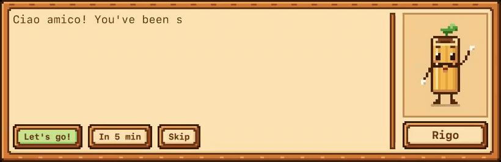
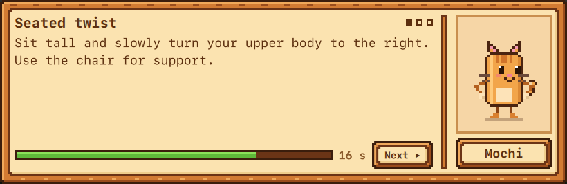
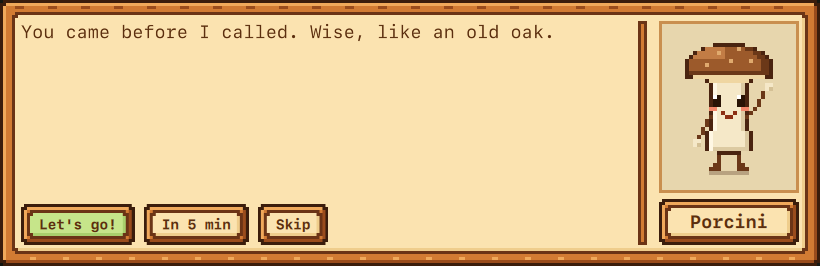
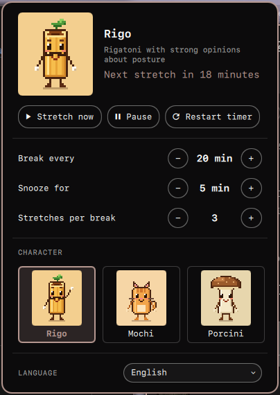
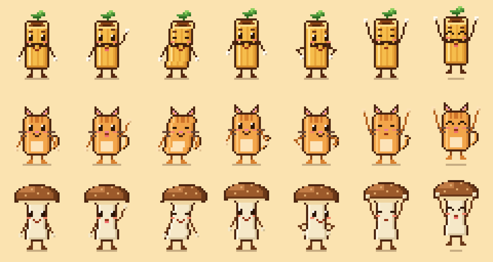

# Stretch Buddies

Stardew-style stretch breaks for Omarchy. Every 20 minutes a pixel-art buddy pops up at the bottom of your screen and walks you through a one-minute neck and back stretch.



- **Three buddies:** Rigo the Rigatoni, Mochi the Cat and Porcini the Mushroom, each with their own voice
- **Seven gentle desk stretches:** three per break, drawn from a shuffle bag so rounds don't repeat
- **Eight languages:** English, Türkçe, Deutsch, Español, Français, Italiano, Русский, हिन्दी
- **Stays out of your way:** the box never takes keyboard focus, clicks outside it pass through, and an unanswered visit skips itself after 15 seconds (hover the box to hold it)
- **Knows when you're away:** five idle minutes or a suspend restarts the sitting clock

| Mochi mid-stretch | Porcini says hello |
|---|---|
|  |  |

## Install

```bash
omarchy plugin add https://github.com/talhacaglar/stretch-buddies.git --enable
```

## Remove

```bash
omarchy plugin remove io.github.talhacaglar.stretch-buddies
```

This disables the widget and deletes the plugin folder. The only other file the plugin writes is `$XDG_RUNTIME_DIR/stretch-buddies.json`, a small state file that is gone at logout. The plugin never edits your configuration on its own: settings are saved to its widget entry in `~/.config/omarchy/shell.json` only when you change them in its panel.

## Use



- **Click:** settings panel (break interval, snooze, stretches per break, buddy, language)
- **Right-click:** pause or resume
- **Middle-click:** stretch now
- **Scroll:** break interval, 5 minutes per step
- **Panel keys:** `s` stretch now, `p` pause, `r` restart the timer, `+` / `-` interval
- **Keybindings and scripts:** `omarchy-shell io.github.talhacaglar.stretch-buddies now`. Other methods: `visit` (a scheduled visit, for testing), `start`, `next`, `pause`, `resume`, `reset`, `dismiss`, `status`

Settings live on the widget entry in `~/.config/omarchy/shell.json`:

| Key | Values | Default |
|---|---|---|
| `intervalMinutes` | 5–120 | 20 |
| `snoozeMinutes` | 1–30 | 5 |
| `exercisesPerBreak` | 1–5 | 3 |
| `character` | `rigo`, `mochi`, `porcini` | `rigo` |
| `language` | `auto` (follows Omarchy), `en`, `tr`, `de`, `es`, `fr`, `it`, `ru`, `hi` | `auto` |

<br clear="right">

## Requirements

- Omarchy 4 (Omarchy Shell)
- No external dependencies
- License: MIT

## How it works

A service, one per shell, owns the countdown and the dialogue box. The box is an overlay layer-shell window with no keyboard focus and an input mask, so only the box itself takes clicks. Replacement bars give bar widgets no access to plugin services, so the widget reads the state file and sends commands over IPC.

The buddies are drawn in code on a 32×40 grid. A pose is a handful of numbers (lean, face offset, arm targets) computed from the clock, so every stretch animation works for every buddy.

## Add a buddy or a language

- **Buddy:** add an entry to `characters` in `Art.js` (colours, body, mouth, extras and a 10×12 bar icon), add its id to `ids`, and give it lines under `<id>.*` in every `i18n/*.json`. Preview the whole cast with `node tools/render-cast.js cast.png`.
- **Language:** copy `i18n/en.json` to `i18n/<code>.json` using the Omarchy language code, translate it, and run `python3 tools/check-i18n.py`. Then add the language to `languages` in `Catalog.qml`, plus a rule in `category()` if its plurals aren't just "one" and "other".



## Notes

- These are gentle, general-purpose desk stretches, not medical advice. Stop if anything hurts.
- In Turkish it goes by *Tatlı Sağlıkçılar*, "sweet little health helpers".
- Built with Claude Code.

MIT
